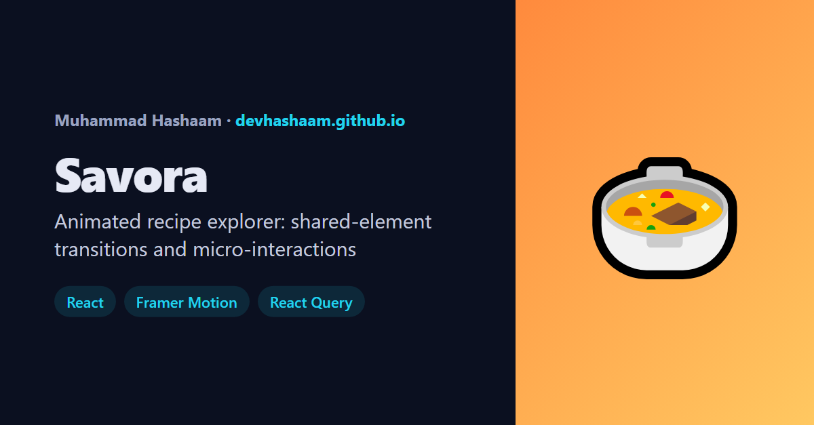

# Savora

An animated recipe explorer built with **React 18, Framer Motion, React Query (TanStack Query) and React Router**, with tests in **Vitest and React Testing Library**.

**Live demo:** https://devhashaam.github.io/savora/



## Animations

| Effect | How it's built |
|---|---|
| **Card → recipe expand** (shared-element transition) | The card frame, image and title share a `layoutId` with the overlay, so they morph into it and back |
| **Grid filtering** | `AnimatePresence mode="popLayout"` + `layout`: removed cards leave at once, the rest glide into place |
| **Sliding category pill** | One `layoutId="chip-pill"` element that springs to whichever chip is active |
| **Staggered entrances** | Variants with `staggerChildren` on the headline; capped per-card delays in the grid |
| **Rotating hero word** | `AnimatePresence mode="wait"` swapping a keyed word on an interval |
| **Heart "pop" + particle burst** | Keyframed scale and 8 particles animated outward with trigonometry |
| **Ingredient checklist** | SVG `pathLength` draws the tick; a background-size trick strikes the text through |
| **Scroll progress bar** | `useScroll` → `useSpring` → `scaleX` |
| **Saved badge bump** | A new `key` per count, so each change pops in |

All motion respects the OS "reduce motion" setting (`<MotionConfig reducedMotion="user">` plus a CSS fallback). Only `transform` and `opacity` animate, so it stays smooth on low-end phones.

## Engineering details

- **Instant first load, even when the API is slow:** a bundled snapshot of every category is used as React Query `initialData`. Because it's marked as old, React Query refreshes it from the API in the background.
- **Instant search:** name matches from the snapshot are shown as `placeholderData`, then replaced by the server's results. A friendly message appears if the API takes longer than 5 seconds.
- **Prefetch on intent:** hovering or focusing a category chip starts loading it.
- **URL state:** category and search live in the query string; a recipe is a real route (`/recipe/:id`) rendered as an overlay on top of the grid, so links can be shared and the back button works.
- **Accessibility:** the dialog is labelled, focus moves to the close button and returns to the card, Escape closes it, all buttons report `aria-pressed`, and counts are announced through live regions.
- **Favourites:** `useReducer` + Context, persisted to `localStorage`, with a memoised context value.

## Project structure

```
src/
  components/  Header, Hero, CategoryBar, MealGrid, MealCard, HeartButton, RecipeOverlay, IngredientList
  pages/       Home (grid + overlay outlet)
  state/       favorites.jsx (Context + useReducer)
  lib/         api.js (TheMealDB client + parsers), router.js
  data/        snapshot.json (generated by scripts/snapshot.mjs)
```

## Run it locally

```bash
npm install
npm run dev     # http://localhost:5173/savora/
npm test        # 17 tests
npm run build
node scripts/snapshot.mjs   # refresh the bundled recipe snapshot
```

---

Built by [Muhammad Hashaam](https://devhashaam.github.io/) · Recipes from [TheMealDB](https://www.themealdb.com/)
